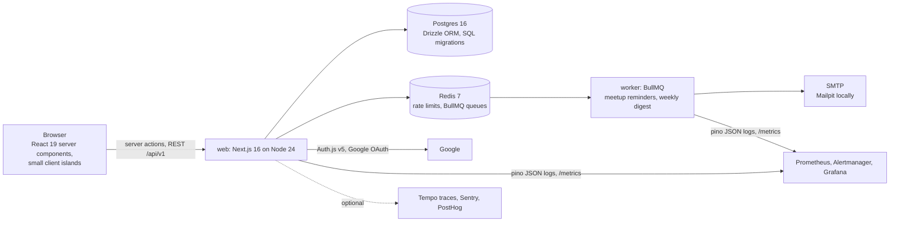

# Coursemates

Study groups for your courses: find people taking the same course, start a group, schedule meetups, RSVP, and
get a reminder an hour before. Built as a real product for USF students rather than a demo, with the things a
product needs around it: Google sign-in, roles and moderation, rate limits, background jobs, accessibility
checks and Lighthouse budgets in CI, metrics and alerts, a privacy policy that says exactly what is stored, and
one-command deploys to free tiers.

Next.js 16 (App Router, Cache Components, React 19), TypeScript strict, Postgres 16 with Drizzle, Redis 7
with BullMQ, Auth.js v5, zod 4, Tailwind 4, Vitest, Playwright + axe, Lighthouse CI, Prometheus and Grafana,
Docker, Fly.io, Neon, Upstash, Terraform.

## Architecture



| Area          | How it is done                                                                                                                                                                                                                                                  |
| ------------- | --------------------------------------------------------------------------------------------------------------------------------------------------------------------------------------------------------------------------------------------------------------- |
| Pages         | App Router with `cacheComponents`: the shell of every page prerenders, per-user content streams behind Suspense. Forms are server actions from plain `<form>` elements, so they work before hydration; small client components add pending states and messages. |
| Data          | Drizzle schema in `src/db/schema.ts`; migrations are SQL files generated by drizzle-kit, applied in CI from zero and by the worker's release command in production; a CI step fails if the schema and the migrations drift.                                     |
| Auth          | Auth.js v5 with Google. JWT sessions carry only the user id; every request resolves it to a fresh `users` row, so a role change or a deleted account takes effect immediately. A password-less development login exists only outside production builds.         |
| Authorisation | Site roles `member < moderator < admin`, group roles `owner`, `member`. Rules are pure functions in `src/lib/rbac.ts` with a test per rule; the data access layer enforces them and private groups answer 404, not 403.                                         |
| Validation    | One zod schema per input, shared by the server actions and the REST handlers.                                                                                                                                                                                   |
| Rate limiting | Redis fixed window in one Lua script: per IP on `/api/*`, per user on mutations (actions included), `429` with `Retry-After`.                                                                                                                                   |
| Jobs          | BullMQ: a delayed reminder per meetup (job id = meetup id, so rescheduling never duplicates; the worker re-checks the meetup and skips stale jobs) and a weekly digest on a job scheduler. Mail through nodemailer to any SMTP.                                 |
| Observability | pino JSON logs, `prom-client` metrics on the web app and the worker, seven promtool-tested alert rules, a Grafana dashboard; OpenTelemetry traces and Sentry are opt-in.                                                                                        |
| Analytics     | PostHog, cookieless: page views only, no autocapture, no session recording, no IP, Do-Not-Track honoured. Weekly active users are counted in our own database.                                                                                                  |
| Delivery      | Dockerfile with `web` and `worker` targets, Compose for everything local, `fly.toml` + `fly.worker.toml`, Terraform for Neon and Upstash, GitHub Actions for CI and deploys, Dependabot.                                                                        |

The five decision records in `docs/decisions/` explain the choices and their consequences.

## What a student sees

- **Find a course** on the home page or `/courses` (32 common USF CS and math courses seeded; anyone can add one when starting a group).
- **Join or start a group** with a size and a visibility; owners schedule meetups, members RSVP (going, maybe, can't), everyone gets an `.ics` feed.
- **Reminders** an hour before each meetup to everyone who has not declined, and a **weekly digest** on Mondays.
- **Report** a group; moderators resolve reports on `/admin`, admins also manage roles. Every moderation action is in an audit log.
- **Delete your account** on your page; groups you own pass to their longest-standing member.
- `/privacy` says what is stored, who sees it, and how long it is kept.

## Results

All numbers come from committed scripts and are reproducible with the commands shown. They were measured on
one machine (Windows 11, Docker Desktop for Postgres and Redis, the production build run with `npm run start`);
they describe this app on that machine, not a hosted instance.

### Weekly active users

<!-- WAU -->

Weekly active users: **not yet measured on a live instance.** The product is built and tested but not yet
deployed or announced; `npm run wau` counts distinct users in `daily_active` over the last 7 days and
`npm run wau -- --write` puts the number here. There is no number to report until real students use it.

<!-- /WAU -->

### Lighthouse (mobile)

`npm run lhci` runs Lighthouse CI three times per page against the production server. The table below was
measured on this workstation. In CI the gate is 90 for accessibility, best practices and SEO and 70 for
performance: GitHub's shared runners score performance lower (0.75 to 0.87 on 2026-10-17), so the CI gate
catches regressions rather than restating the local number.

<!-- LIGHTHOUSE -->

| Page       | Performance | Accessibility | Best practices | SEO | LCP (median) | TBT (median) | CLS  |
| ---------- | ----------- | ------------- | -------------- | --- | ------------ | ------------ | ---- |
| `/`        | 96          | 100           | 96             | 100 | 2.9 s        | 50 ms        | 0.00 |
| `/courses` | 95          | 100           | 96             | 100 | 2.9 s        | 61 ms        | 0.00 |
| `/privacy` | 96          | 100           | 96             | 100 | 2.9 s        | 49 ms        | 0.00 |

Lighthouse 12.6.1, mobile form factor with Lighthouse's default throttling, 3 runs per page, median shown; scores are out of 100. Collected by `npm run lhci` against `npm run start` on one machine; the raw reports are in `.lighthouseci/`, the summary in `load/results/lighthouse-latest.json`.

<!-- /LIGHTHOUSE -->

### Page load under steady load (k6)

`make load` runs k6 in a container against the production server: 10 virtual users, 60 s, each iteration
fetching every public page and the groups API once.

<!-- K6 -->

| Page               | p50   | p95   | p99   |
| ------------------ | ----- | ----- | ----- |
| `/`                | 50 ms | 65 ms | 78 ms |
| `/courses`         | 64 ms | 83 ms | 98 ms |
| `/courses/COP4530` | 60 ms | 79 ms | 91 ms |
| `/privacy`         | 47 ms | 62 ms | 74 ms |
| `/api/health`      | 13 ms | 19 ms | 24 ms |

12,465 requests, 0.00% failed, overall p95 74 ms, 10 virtual users for 60s, run 2026-10-17 12:46 UTC. k6 in a container (grafana/k6) against `npm run start` on the same machine, constant VUs, each iteration fetches every page once; durations are full HTTP response times in milliseconds.

<!-- /K6 -->

### Tests

| Suite                                                         | Count                      | What it covers                                                                                                                                                                                               |
| ------------------------------------------------------------- | -------------------------- | ------------------------------------------------------------------------------------------------------------------------------------------------------------------------------------------------------------ |
| Vitest unit                                                   | 23                         | authorisation rules, validation and normalisation, reminder timing, e-mail templates, calendar feed, environment guard                                                                                       |
| Vitest integration (Testcontainers: Postgres, Redis, Mailpit) | 18                         | migrations from zero, capacity under concurrent joins, private visibility, reminders through to the inbox, rate limiter, role changes, account deletion hand-over, the API wrapper (401/403/400/409/500/429) |
| Playwright end to end                                         | 18                         | the full owner, member and moderator flow against the production build; axe checks (WCAG 2.1 AA, serious and critical) on 8 pages, desktop and mobile                                                        |
| promtool                                                      | 8 scenarios, 10 assertions | each alert fires when it should and stays quiet when it should not                                                                                                                                           |
| Lighthouse CI                                                 | 3 pages                    | performance, accessibility, best practices and SEO at or above 90                                                                                                                                            |

CI (`.github/workflows/ci.yml`) runs lint, format, types and unit tests; migrations from zero plus drift
check; integration tests; the e2e and axe suite against a built app; Lighthouse CI; promtool; Terraform fmt
and validate; gitleaks and `npm audit`; and both Docker images.

## Running it

```bash
cp .env.example .env            # set AUTH_SECRET: openssl rand -base64 32
make up                         # Postgres, Redis, Mailpit (http://localhost:8026)
npm ci && npm run db:migrate && npm run seed
npm run dev                     # http://localhost:3100
npm run worker                  # second terminal
```

Sign in with the development login (any e-mail) and make yourself admin with
`npm run seed -- --admin you@example.edu`. `make up-obs` adds Prometheus, Alertmanager, Grafana (dashboard
"Coursemates") and Tempo. `docs/DEPLOY.md` has the test commands, the Fly.io deployment and the teardown.

### API

Every endpoint validates with zod, is rate limited, and returns `{ error, code?, fields? }` on failure.

| Method and path                                      | Who                                      | Does                                              |
| ---------------------------------------------------- | ---------------------------------------- | ------------------------------------------------- |
| `GET /api/v1/courses?q=`                             | anyone                                   | search courses                                    |
| `POST /api/v1/courses`                               | signed in                                | add a course                                      |
| `GET /api/v1/groups?course=&q=&page=`                | anyone (private groups only for members) | list groups                                       |
| `POST /api/v1/groups`                                | signed in                                | create a group (adds the course if given a title) |
| `GET /api/v1/groups/{id}`                            | anyone who may see it                    | group, members, upcoming meetups                  |
| `PATCH /api/v1/groups/{id}`                          | owner or admin                           | edit, archive                                     |
| `POST /api/v1/groups/{id}/join`, `.../leave`         | signed in                                | membership                                        |
| `GET /api/v1/groups/{id}/calendar.ics`               | anyone who may see it                    | iCalendar feed                                    |
| `POST /api/v1/meetups`, `PATCH /api/v1/meetups/{id}` | owner or admin                           | schedule, move, cancel                            |
| `POST /api/v1/meetups/{id}/rsvp`                     | member                                   | going, maybe, no                                  |
| `POST /api/v1/reports`                               | signed in                                | report a group, meetup or user                    |
| `POST /api/v1/admin/reports/{id}`                    | moderator                                | resolve or dismiss                                |
| `PATCH /api/v1/admin/users/{id}/role`                | admin                                    | change a role                                     |
| `GET /api/v1/me`                                     | signed in                                | my groups and upcoming meetups                    |
| `GET /api/health`, `GET /api/metrics`                | anyone, Prometheus                       | dependencies check, metrics                       |

## Security and privacy

- Google OAuth through Auth.js; the app never sees a password. The dev login cannot exist in a production build (unit-tested).
- Every mutation re-reads the caller's role; authorisation rules are unit-tested pure functions; private groups do not reveal their existence.
- Rate limits per IP and per user, in Redis, shared across instances.
- Strict security headers and a Content-Security-Policy from `next.config.ts` (the partially prerendered shell cannot carry a per-request nonce, so inline scripts are allowed and everything else is locked down).
- Secrets only in the environment or Fly secrets; `.env` is ignored; gitleaks and `npm audit` run in CI; Dependabot keeps npm, Docker, Actions and Terraform current.
- Non-root containers; the worker image runs the migrations so the web image contains only the built app.
- Personal data is limited to what Google returns plus what the user does here; `/privacy` lists it, and "Delete my account" removes it.

## Deployment

Fly.io (two apps from one Dockerfile), Neon Postgres and Upstash Redis via Terraform, Google OAuth client,
optional Sentry and PostHog. `make deploy` and `make teardown`; the GitHub `deploy` workflow does the same
with `FLY_API_TOKEN`. Everything fits the providers' free tiers. Steps and secrets are in `docs/DEPLOY.md`.

## Limitations

- Not deployed yet, so there are no real users and no weekly-active-users number; the measurement is in place.
- Single-region, single-instance numbers; the Lighthouse and k6 results are from one machine over localhost.
- Reminders are one job per meetup, not per recipient: a failure half-way retries the whole job and can re-send to people who already got the mail.
- The CSP allows inline scripts because the prerendered shell cannot carry a nonce; XSS protection rests on React's escaping and the other directives.
- Traces are opt-in because a registered tracer provider makes Next.js render the page shells dynamically (ADR 0005).
- The course list is a starter; it is not synced with the university catalogue.

## Layout

```
src/app/            pages, layouts, server actions, route handlers (/api)
src/components/     navigation, forms, fields, buttons
src/server/         data access layer: users, courses, groups, meetups, reports, session, guard
src/lib/            env, validation, rbac, rate limiter, queue, e-mail, metrics, logger, http wrapper
src/db/             Drizzle schema, client, seed
src/worker/         BullMQ worker (reminders, digest) with its metrics endpoint
drizzle/            SQL migrations
tests/              Vitest unit and integration tests
e2e/                Playwright flows and axe checks
observability/      Prometheus, alert rules and tests, Alertmanager, Grafana, Tempo
load/               k6 script and results
infra/terraform/    Neon and Upstash
scripts/            migrate, wau, render-results, deploy, teardown
docs/               PLAN.md, DEPLOY.md, decisions/
```

## License

MIT.
