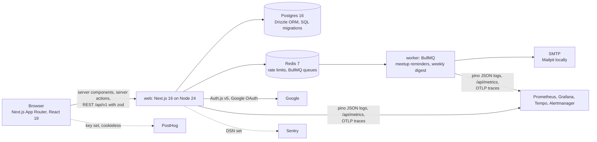

# Plan: fullstack-ts-product (Coursemates)

Goal: a product USF students would actually use, built and run the way a small product team would run it:
Coursemates lets students find or start a study group for a course they are taking, schedule meetups, RSVP,
get a reminder before each meetup and a weekly digest, and report abuse to moderators. Signed in with Google.
The point is real weekly active users, measured by a committed script, not a demo.

Targets: React/TypeScript in 27-28% of software postings; Affirm, JPMorgan and Galatea full-stack roles.

## Architecture

| Piece                | Choice                                                                                                                                                                                                  | Why                                               |
| -------------------- | ------------------------------------------------------------------------------------------------------------------------------------------------------------------------------------------------------- | ------------------------------------------------- |
| Framework            | Next.js 16 App Router, TypeScript strict, React 19 server components                                                                                                                                    | the stack the postings name                       |
| Data                 | Postgres 16, Drizzle ORM, SQL migrations generated by drizzle-kit and applied in CI                                                                                                                     | migrations as reviewable files                    |
| Auth                 | Auth.js v5 with Google; a Credentials "dev login" provider only when `AUTH_DEV_LOGIN=true` (never in production builds)                                                                                 | Playwright and local work without a Google client |
| Authorisation        | site roles `member`, `moderator`, `admin`; group roles `owner`, `member`; every mutation goes through `requireUser` / `requireRole` / `requireGroupRole`                                                | role-based access is a must-have                  |
| Validation           | zod 4 schemas shared by server actions and `/api/v1` route handlers                                                                                                                                     | one definition per input                          |
| Rate limiting        | Redis fixed window per IP on `/api/*` and per user on mutations, `429` with `Retry-After`                                                                                                               | cheap, testable, works across instances           |
| Jobs                 | BullMQ 6 on Redis: `reminders` (delayed job per meetup, id = meetup id, rescheduled on edit) and `digest` (repeatable weekly); a separate `worker` process                                              | reminders survive restarts; idempotent by job id  |
| Email                | nodemailer to SMTP; Mailpit in Compose                                                                                                                                                                  | no provider account needed locally                |
| Observability        | pino JSON logs with request ids, `prom-client` histograms at `/api/metrics` (web and worker), OpenTelemetry traces via `@vercel/otel` to Tempo, Grafana dashboard, 5 alert rules with promtool tests    | the same bar as the other projects                |
| Errors and analytics | `@sentry/nextjs` (DSN from env, off when empty), PostHog with `persistence: memory`, no autocapture, no session recording, honoured Do-Not-Track, disclosed on `/privacy`                               | privacy-respecting as the spec asks               |
| Tests                | Vitest unit tests; Vitest integration tests against Postgres and Redis in Testcontainers; Playwright end to end with axe accessibility checks; Lighthouse CI mobile ≥ 90 on `/`, `/courses`, `/privacy` | unit, integration, e2e, a11y, performance         |
| Deploy               | Dockerfile (standalone output, non-root), `fly.toml` with `web` and `worker` processes, Terraform for Neon Postgres and Upstash Redis, GitHub Actions deploy with `FLY_API_TOKEN`                       | free tiers; one command up and down               |

## Data model

`users` (Auth.js) + `role`, `last_seen_at`; `accounts`, `sessions`, `verification_tokens` (Auth.js);
`courses` (code, title; seeded with common USF CS and math courses, users can add); `groups` (course, name,
description, capacity, visibility, owner, archived); `memberships` (group, user, role); `meetups` (group,
starts_at, ends_at, location, notes); `rsvps` (meetup, user, status); `reports` (target, reporter, reason,
status, resolver); `daily_active` (user, day) for weekly active users; `audit_log` for moderation actions.

## Pages and API

`/` (search courses and groups), `/courses`, `/courses/[code]`, `/groups/new`, `/groups/[id]` (members,
meetups, RSVP, calendar export), `/me`, `/admin` (reports, roles), `/privacy`, `/signin`.
`GET /api/v1/courses?q=`, `GET|POST /api/v1/groups`, `POST /api/v1/groups/{id}/join|leave`,
`GET /api/v1/groups/{id}/calendar.ics`, `POST /api/v1/meetups`, `POST /api/v1/meetups/{id}/rsvp`,
`POST /api/v1/reports`, `POST /api/v1/admin/reports/{id}/resolve`, `PATCH /api/v1/admin/users/{id}/role`,
`GET /api/health`, `GET /api/metrics`.

## Numbers to produce

- Weekly active users: `scripts/wau.ts` counts distinct users in `daily_active` over the last 7 days. Zero
  until the product is deployed and announced; the README says so rather than inventing a number.
- p95 page load: Lighthouse CI (mobile, throttled) scores and LCP for `/`, `/courses`, `/privacy`, plus a k6
  run against the production build on one machine (p95 time to first byte and full response for the same pages).
- Test count: Vitest unit and integration, Playwright, axe pages, Lighthouse pages.

## Milestones

| #   | Milestone                                                                                             | Done when                                                                                |
| --- | ----------------------------------------------------------------------------------------------------- | ---------------------------------------------------------------------------------------- |
| 1   | Schema, migrations, seed, Auth.js with Google and dev login, roles                                    | `drizzle-kit migrate` from zero; sign in locally; `requireRole` unit tests               |
| 2   | Courses, groups, memberships, meetups, RSVPs: pages, server actions, `/api/v1` with zod               | integration tests against Testcontainers Postgres                                        |
| 3   | Rate limiting, reports and moderation, admin page, audit log                                          | integration tests with Redis; 429 asserted                                               |
| 4   | Jobs: reminders and digest in BullMQ, worker process, Mailpit                                         | integration test: reminder job enqueued at the right time and e-mail received in Mailpit |
| 5   | Observability: pino, metrics, OTel, dashboard, alerts with promtool tests; Sentry and PostHog wiring  | `/api/metrics` scraped; alert tests pass                                                 |
| 6   | Playwright e2e with axe; Lighthouse CI mobile ≥ 90; k6 p95                                            | all green locally against `next start`                                                   |
| 7   | Dockerfile, Compose, fly.toml, Terraform (Neon, Upstash), deploy and teardown scripts, CI, Dependabot | CI green; Terraform validates                                                            |
| 8   | README, privacy policy, ADRs 0001-0005, PROJECT-FACTS entry                                           |                                                                                          |

## Cost

Zero while local. Deployed: Fly.io free allowance (two shared-cpu-1x machines), Neon free tier, Upstash free
tier, Sentry and PostHog free tiers; all accounts and secrets are manual steps listed in
`_portfolio/MANUAL-STEPS.md`. Teardown: `make teardown` destroys the Fly apps and the Terraform resources.

## Status (2026-10-17)

| #   | Milestone                                            | Status                                                                                                                  |
| --- | ---------------------------------------------------- | ----------------------------------------------------------------------------------------------------------------------- |
| 1   | Schema, migrations, seed, Auth.js, roles             | done: one migration applied from zero in CI and tests; Google + dev login; JWT sessions re-read per request             |
| 2   | Courses, groups, memberships, meetups, RSVPs         | done: pages, server actions and `/api/v1`; integration tests against Testcontainers Postgres                            |
| 3   | Rate limiting, reports, moderation, admin, audit log | done: Redis fixed window per IP and per user; 429 asserted in the API wrapper tests                                     |
| 4   | Jobs: reminders and digest                           | done: BullMQ with deterministic ids; integration test reads the reminder back out of Mailpit                            |
| 5   | Observability, Sentry, PostHog                       | done: pino, prom-client, 7 alert rules with promtool tests, Grafana dashboard; traces and Sentry opt-in                 |
| 6   | Playwright + axe, Lighthouse, k6                     | done: 18 e2e tests, 8 pages axe-clean, Lighthouse 95-96 performance / 100 accessibility on mobile, k6 p95 in the README |
| 7   | Dockerfile, Compose, Fly, Terraform, CI              | done: two image targets, Compose with profiles, fly.toml + fly.worker.toml, Terraform validated, 9 CI jobs              |
| 8   | README, privacy policy, ADRs                         | done                                                                                                                    |

Not done: deployment and real users (needs his Fly, Neon, Upstash and Google accounts; listed in
`_portfolio/MANUAL-STEPS.md`).
